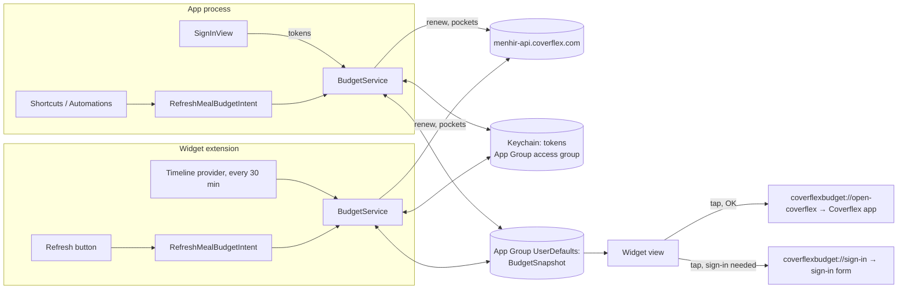

# Coverflex Budget

iOS app and Home Screen widget that show the Coverflex meal card balance.

- **App**: sign in with email, password, and OTP code. Stores the Coverflex tokens in the Keychain. Never stores the password.
- **Widget** (small): balance, refresh button, last update time.
  - Tap opens the Coverflex app (through `https://my.coverflex.com`, a Coverflex universal link).
  - When the session expired, tap opens this app at the sign-in form.
- **Shortcuts**: "Refresh Meal Budget" action. Updates the widget and returns the balance in euros. Fails when the session expired.



## Build

```sh
brew install xcodegen
xcodegen generate
open CoverflexBudget.xcodeproj
```

Signing uses team `5JCZ9B7BDM` (see `project.yml`). Xcode registers the bundle IDs and the
`group.com.gmcabrita.CoverflexBudget` App Group on the first device build.

## Install with AltStore or SideStore

```sh
./scripts/build-ipa.sh
```

Then install `build/CoverflexBudget.ipa` from AltStore ("My Apps" → "+").

- AltStore renames the App Group to `group.com.gmcabrita.CoverflexBudget.<TEAMID>` and writes the new
  name to `ALTAppGroups` in each `Info.plist`. `AppGroup.identifier` reads that key.
- The app uses 2 App IDs (app and widget) of the 10 that a free account can create in 7 days.
- AltStore refreshes the signature every 7 days. The tokens and the snapshot stay on the device.

## Tests

Shared logic lives in `Packages/CoverflexCore` and runs on macOS:

```sh
cd Packages/CoverflexCore && swift test
```
