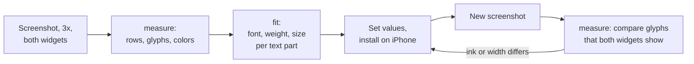

# Widget design

The small widget copies the layout of the Revolut account balance widget. All values come from
measurements of iPhone screenshots that show the two widgets side by side.

## Values

| Element | Value | Source |
|---|---|---|
| Padding | 16 pt on all sides (`contentMarginsDisabled`) | Text and button positions |
| Label | Inter 500, 14 pt, `#717173` | `fit`, then same letters in both widgets |
| Amount, whole part | Inter 700, 24 pt, `#191C1F` | `fit`, then corrected for the Mac bias (see below) |
| Amount, rest (`,25 €`) | Inter 500, 16 pt | Same glyphs in both widgets (`,` `2` `€`) |
| Badge | 20 pt circle, centered on the label line | Position and size |
| Button | 48 pt circle, fill `#F7F7F7`, icon 19 pt bold | Position, size, pixel color |
| Optical size | Fixed at 14 (Inter "text" design) | See "Inter 3 and Inter 4" |

The constants are in `Widget/MealBudgetWidget.swift` (`Layout`) and `Widget/InterFont.swift`.
Dark mode uses system colors; it has no reference.

## Method

1. Take a 3x iPhone screenshot with the reference widget on the left and this widget on the right.
2. `swift scripts/compare-widget.swift measure <screenshot>` finds both widgets and prints each
   text row, each glyph (position, size, ink), the text color, and the button fill. Positions are
   in points from the widget's top-left corner.
3. `swift scripts/compare-widget.swift fit <screenshot> <widget> <row> <text> [<first> <last>]`
   renders the text with Inter and the system font at many weights and sizes and ranks the matches.
   For a row with 2 fonts, give the glyph indexes of one part.
4. Set the values, build, install, and take a new screenshot.
5. Compare the glyphs that both widgets show. Example: `,` `2` `€` in `,82 €` and `,25 €`. The same
   glyph in the same font, size, and weight has the same width and ink (±2%). More ink means a
   heavier weight or a larger size; equal height with more ink means a heavier weight.

## Things that went wrong

- **The Mac draws text darker than the iPhone.** On the same glyphs, iPhone ink is about 75% (regular)
  to 81% (bold) of the Mac render. `fit` compares the phone screenshot with Mac renders, so its
  weights can be too light: it gave 400–450 for the cents, and the phone comparison gave 500.
  Use `fit` to find the font and the size. Use step 5 for the final weight.
- **Inter 3 and Inter 4.** Inter 4 (`InterVariable.ttf`) has an optical size axis: at large sizes it
  uses thinner, narrower "display" shapes. Revolut ships the static Inter 3 files, which only have the
  text design. With automatic optical size our amount was too light. `Font.inter` fixes the axis at 14.
- **Do not guess the font from the shape.** An early attempt chose the system font from width and
  ink only. The `€` showed the error: Inter's `€` differs from the system `€`. `fit` compares the
  full glyph shapes and found Inter clearly (half the difference of the best system font match).

## Limits

- The widget icons are system symbols. Revolut uses its own icons with rounded line ends.
- Do not copy files from the Revolut app. Inter is from the official release (SIL Open Font
  License, `Widget/Fonts/Inter-LICENSE.txt`).
